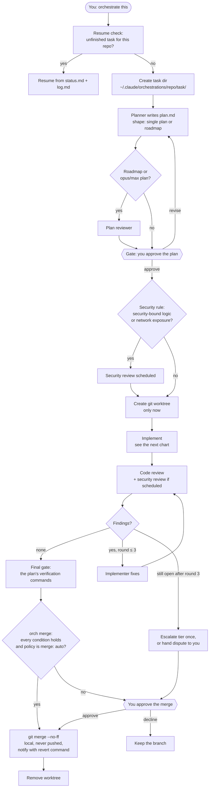
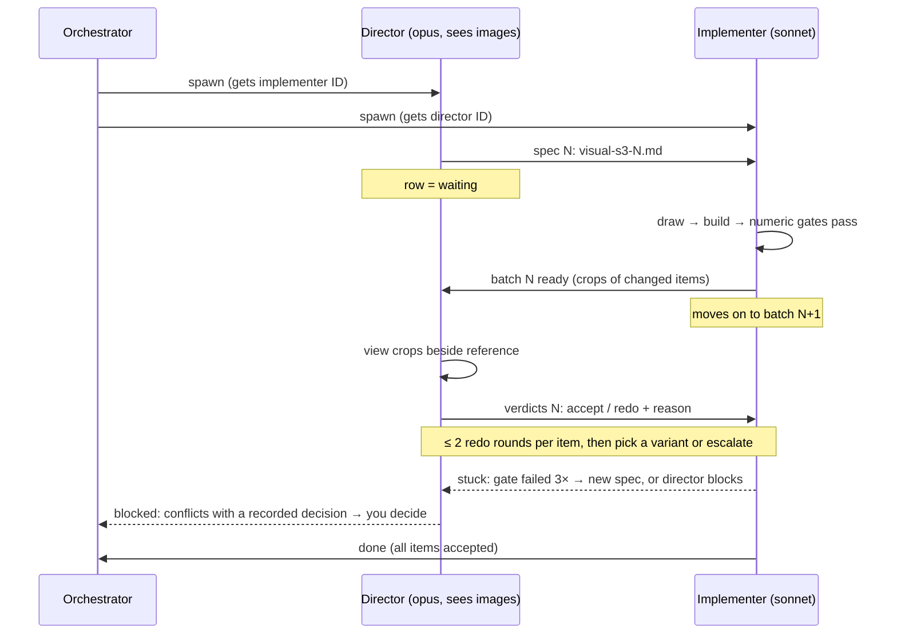
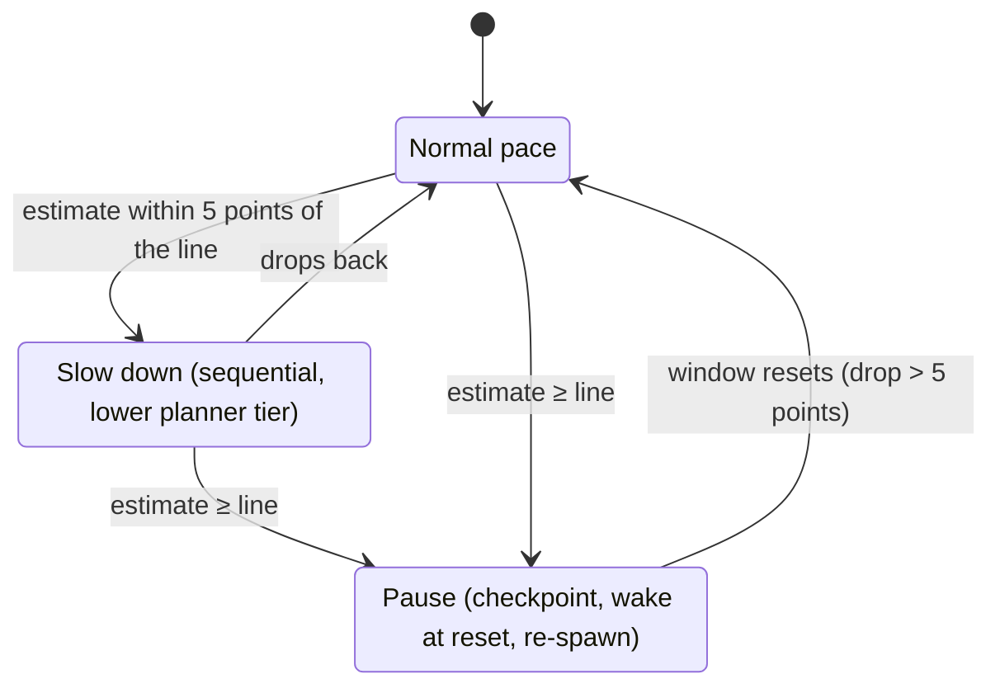
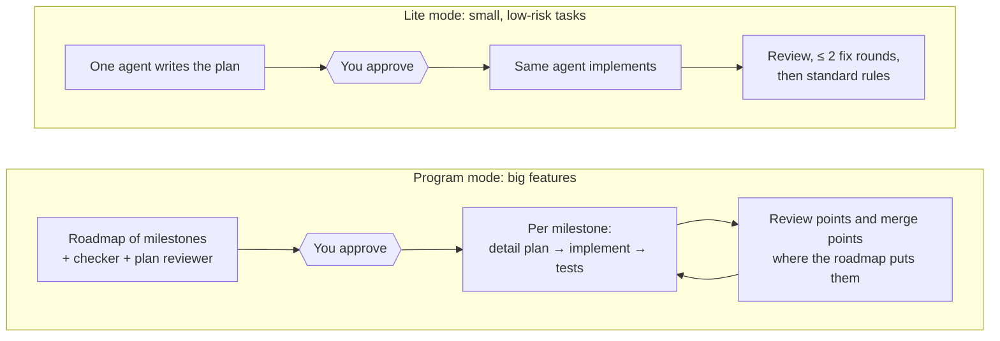

# orch

orch is a multi-agent orchestration skill for [Claude Code](https://code.claude.com). The work
moves through these steps:

1. A **planner** writes a plan, and you approve it.
2. An **implementer** carries out the plan in its own git worktree.
3. A **code reviewer** checks the diff, for up to 3 fix rounds. A **security reviewer** also runs
   when a rule says so: a step implements security-bound logic, or the change adds network exposure.
4. When review and the final gate are clean, the orchestrator merges the branch into your base
   branch with a local `git merge --no-ff`. It never pushes. If any merge condition fails, it asks you.

All state lives in Markdown files on disk, so a task survives a crashed session. The orchestrator
picks each role's model and effort level per spawn, records every choice in a journal, and paces
itself against your 5h/7d usage limits. It estimates your live 5h usage, slows down near a dynamic
stop line (about 95-99%), pauses at it, and resumes on its own when the window resets.

Status: in active use, still changing.

## Why use it

You approve the plan. The agents (blue) do the rest, including the build-and-review loop and a
clean merge. They come back to you (yellow) only for what they can't decide or undo themselves.


- **You stay in charge where it matters.** You approve the plan before any code is written. Between
  that gate and the merge it runs on its own. A clean merge is a local `--no-ff` that is journaled with
  a revert command and never pushed. A failed merge condition, a repo whose `policy.md` says
  `merge: ask`, a push, a usage stop, sudo or a paid action all come to you.
- **Questions queue.** When a role needs a decision, a reversible one outside the sensitive areas is
  taken (the recommended option, recorded and listed in the digest). Anything else is parked in the task's `questions.md` and
  everything it doesn't block keeps going. You get one batched question when nothing independent is left.
  A notification goes out only for a parked question, an automatic merge, a hard stop or the end of a task.
- **Work survives crashes and usage limits.** All state lives in Markdown files: plan, status, log,
  review and journal. A dead session, a closed terminal or a usage pause resumes from the files, not
  from scratch.
- **Separate reviewers check the work.** A code reviewer with a fresh context, plus a security reviewer
  when the rule fires (security-bound logic or network exposure; `policy.md` can force it or ask first).
  Every run or skip is journaled. They review against the approved plan, for up to 3 fix rounds.
- **Bookkeeping is one command.** `orch` does each state change in a single call, writes each role's
  brief (just its context), checks the plan, and runs the merge guard. `orch dashboard --serve` shows
  your tasks on a local page.
- **It spends usage deliberately.** A cheap Sonnet implementer does most of the work. Opus plans and
  reviews, and a step escalates to a stronger tier only for a stated reason, which goes in the journal.
  It paces itself against your 5h/7d limits, so a long task pauses instead of hitting the wall.
- **Runs are bounded.** Pilot batches measure cost before a big step. Check-ins catch a silent agent
  that's looping, and three strikes stop retry spirals.
- **It learns.** Mistakes go into a `LESSONS.md`. Lessons that change behaviour get promoted into the
  skill itself, and every decision is journaled for later analysis.

## How it differs from other ways to run agents

| | Plain subagents / one long session | `/goal` (Claude Code) | Dynamic workflows (Claude Code) | **orch** |
|---|---|---|---|---|
| Who decides "done" | the agent itself | a small model reads the conversation after each turn | the script | reviewers against the approved plan, then a merge guard in code (or you, when it fails) |
| Human gates | ad hoc | none until the condition is met | none mid-run | plan approval, then only hard stops, parked questions and a merge the guard refuses |
| Survives a crash | no | goal restored on resume; counters reset | no | yes: every role checkpoints to files |
| Isolation | your branch | your branch | your branch | its own git worktree until the merge |
| Model per role | one | one, plus an evaluator | per agent | per role and per spawn, with a written tradeoff |
| Loop limits | none | a turn cap you write yourself | per script | 3 review rounds, 2 visual redo rounds, three strikes, check-ins |
| Usage pacing | none | pauses on limits | none | estimates live usage, slows near a dynamic stop line (about 95-99%), pauses at it, resumes on its own |

Use `/goal` when one agent can reach a checkable end state, like "tests pass". Use dynamic workflows
for wide fan-out with no human in the loop. Use orch for multi-step engineering work where you want
a plan you approve, independent review and a merge that is local, journaled and revertible.

## Track record (the old skill, before 2026-10-22)

These numbers describe the skill as it was before 2026-10-22: security reviewer by offer, you
approving every merge, bookkeeping by hand. Nothing here measures the current version.

The workflow goes back to late December 2025. It began as a project-specific orchestration skill
inside one repository and evolved into this standalone skill. Records were only kept from
2026-08-27, so the numbers below cover about the last seven weeks, not the whole history. They come
from the skill's own records. Journaled outcomes start on 2026-09-26, when the journal was added. Review findings
are counted from the review files themselves.

| | |
|---|---|
| Tasks run | 84 across 13 repositories |
| Journaled task ends since 2026-09-26 | 41: 36 merged, 1 abandoned, 4 with no outcome recorded |
| Plans | 46 approvals at the gate, 5 sent back for revision there; 13 mid-task revisions (5 after a blocker, 8 asked for by the user) |
| Caught by code review before merge | 18 blockers, 205 should-fix and 287 nits, over 66 reviews |
| Caught by security review | 3 high, 15 medium and 36 low, over 23 reviews |
| Blockers raised by roles | 31; 13 resolved by the orchestrator itself, 4 by a side investigation, 14 by asking the user |
| Usage-limit pauses | 5 pauses, 7 automatic resumes |
| Lessons | 15 promoted from `LESSONS.md` into standing rules |

### What changed because of the data (before 2026-10-22)

- **Tiers chosen per spawn** (2026-10-08). Mean review rounds on merged standard tasks fell from 2.7
  (n=11) to 2.1 (n=9).
  Escalations went from barely logged to logged every time.
- **Batching implementers into ≤ 2 steps** was tried and reverted (2026-10-03). Measured volume went
  up, not down.
- **Planner sketches** are kept under watch. 10 of 48 were judged wrong, so they stay an experiment
  rather than a rule.
- **A full audit on 2026-10-15** found duplicated and drifted role rules and fixed them. The same
  scenarios were run against the old and new role files: existing behaviour scored the same (20/21
  each), and the fixes passed 42/42.

### Not proven yet

- The `orch` command, the stop policy, the automatic merge and the security rule (2026-10-22) have
  unit tests but no old-versus-new measurement of cost or behaviour yet.
- The visual director loop, pilot batches, check-ins and three strikes were added on 2026-10-15.
  None has run in a real task yet.
- Program mode (roadmaps of milestones) has been used once.
- The numbers above come from one person's projects. Your mileage will vary with codebase and model
  versions.

## How it works

### The main flow

You approve at two gates, the plan and the merge. Everything between them runs on its own.



### Inside "Implement": the loops that keep a step bounded


### Visual steps: a director judges, a cheaper implementer draws

For steps whose acceptance needs eyes (glyphs, UI, images). The two agents talk directly through
one-line messages that point at a file. The file, `visual-s<step>-<N>.md`, is the record.



### Usage pacing

It reads your 5h usage window from a local cache and the session transcripts, and estimates the
current figure between cache updates (`orch usage`). The stop line is dynamic, usually 95-99%: lower when
stopping would cost more (a prompt-cache re-write, live subagents) or the estimate is less certain. A silent
background command (`orch usage wait`) wakes the orchestrator only on an event: stop, reset, check-in. No
network calls.



### Other modes



Every decision (tier choice, escalation, gate, pilot, check-in) is appended to `journal.jsonl`,
and `bin/orch-stats.sh` aggregates the journals across tasks.

## What's in it

| Path | What |
|---|---|
| `skills/orchestrate/SKILL.md` | The procedure the orchestrator follows |
| `skills/orchestrate/PROGRAM.md` | Program mode: a roadmap of milestones for big features |
| `skills/orchestrate/TIERS.md` | Guide for choosing each role's model and effort |
| `skills/orchestrate/templates/` | One template per task file: plan, status, log, review, journal, … |
| `agents/orch-*.md` | Roles: planner, implementer, code reviewer, security reviewer, plan reviewer, director (visual judgement), explorer, executor. **Generated**, do not edit |
| `skills/orchestrate/roles/` | Role sources; `_shared/` holds blocks every role includes |
| `bin/orch-build-agents.py` | Renders `roles/` into `~/.claude/agents/orch-*.md`. Agent files can't import other files at runtime, so shared rules are inlined at build time |
| `bin/orch-build-hook.sh` | PostToolUse hook: re-runs the build whenever a Write, Edit or Bash call touches `roles/`, and reports a failed build back to Claude |
| `agents/orch-explorer.md`, `agents/orch-executor.md` | Cheap helpers that any role (or any session) can call: read-only lookups, and builds/tests that report a digest. Named `explorer`/`executor` before 2026-10-22 |
| `bin/usage-check.sh`, `bin/usage-watch.sh` | One-shot wrapper around `orch usage` (the live estimate and dynamic stop line), and a legacy fixed-threshold watchdog. Local files only, no network |
| `bin/orch-ratelimit-cache.sh` | Writes that cache, and the shared sample log, from the statusline input |
| `bin/orch-index.sh`, `bin/orch-index-hook.sh` | Keep `~/.claude/orchestrations/ACTIVE.md`, the list of unfinished tasks |
| `bin/orch-stats.sh`, `bin/role-cost.py` | Analytics over the journals and transcripts |
| `bin/orch-program-check.py` | Checks a program roadmap against its rules |
| `bin/orch`, `bin/orchlib/` | The `orch` command: one call per state change (`spawn`, `return`, `role`, `journal`, `ask`), role briefs, plan checks, the guarded `merge`, and `migrate` for old task directories. Python 3.9+ standard library only; `orchlib/tests/` holds its tests |
| `bin/orchlib/dashboard.py`, `bin/orchlib/dashboard.html` | `orch dashboard`: a read-only page of active tasks, questions waiting for you and recent events, served on 127.0.0.1 only |
| `skills/orchestrate/templates/policy.md`, `…/questions.md` | Per-repo stop policy (`~/.claude/orchestrations/<repo>/policy.md`) and the queue of parked questions in a task |

## Install

Requires Claude Code, `git`, `jq` and Python 3.9 or newer.

```bash
git clone <this repo> orch && cd orch
./install.sh --dry-run   # list what would change
./install.sh             # copy into ~/.claude; any replaced file is backed up first
```

Then add the following to `~/.claude/settings.json`:

```jsonc
{
  "hooks": {
    "PostToolUse": [{ "matcher": "Write|Edit|Bash",
      "hooks": [{ "type": "command", "command": "$HOME/.claude/bin/orch-index-hook.sh" },
                { "type": "command", "command": "$HOME/.claude/bin/orch-build-hook.sh" }] }],
    "SessionStart": [{ "hooks": [{ "type": "command",
      "command": "$HOME/.claude/bin/orch-index.sh >/dev/null 2>&1 || true" }] }]
  },
  // Usage pacing needs the rate-limit cache. Use this as your statusline...
  "statusLine": { "type": "command", "command": "$HOME/.claude/bin/orch-ratelimit-cache.sh --print" }
  // ...or, if you already have a statusline script, pipe its stdin through:
  //   input=$(cat); printf '%s' "$input" | ~/.claude/bin/orch-ratelimit-cache.sh
}
```

To run `orch` as a bare command, link it onto your `PATH` (optional):

```bash
ln -s ~/.claude/bin/orch ~/.local/bin/orch
```

### Upgrading an existing install

```bash
cd orch && git pull
./install.sh --dry-run   # lists new and changed files; new: bin/orch, bin/orchlib/…
./install.sh             # replaced files are backed up first
~/.claude/bin/orch migrate --dry-run   # report what would change in your task directories
~/.claude/bin/orch migrate             # add the new status.md fields to active tasks
~/.claude/bin/orch migrate --all       # optional: finished tasks too
```

`orch migrate` only touches `status.md`. It backs up every file it changes under
`~/.claude/orchestrations/.migrate-backup-<time>/` and never rewrites a plan. Run it when no
session is working on those tasks. Task directories made before the upgrade stay readable; migrating
fills in the new fields, and writes `unknown` where it can't tell. `orch` needs Python 3.9+ and `git`
on the `PATH`.

Without the cache, `usage-check.sh` reports `UNKNOWN`. The skill treats `UNKNOWN` as a warning, so
it runs slowed down the whole time and can't auto-pause or resume. Rate limits appear in the
statusline input only on Pro/Max plans.

To have Claude offer the mode on its own, add a line like this to `~/.claude/CLAUDE.md`:

> Before a new feature, or a bugfix or refactor that spans several files, offer the orchestration
> mode (standard, or lite for small low-risk tasks) alongside normal single-session mode.

## Use

Say "orchestrate this" (or "lite mode" for a small task) and describe the work. Task files go to
`~/.claude/orchestrations/<repo>/<task>/`.

To watch your tasks, run `orch dashboard --serve` (add `--port N` to change the port, `--open` to open
a browser). It serves a read-only page on `127.0.0.1:8765` and writes nothing. `orch dashboard --json`
prints the same data once.

## Maintaining (for the repo owner)

This repo is a sanitised **export** of a live `~/.claude` install. The live files are the source
of truth.

1. Edit the skill in `~/.claude`. For a role, edit `skills/orchestrate/roles/`; never edit
   `agents/orch-*.md` directly. The build hook regenerates them after each edit made inside Claude
   Code. After editing outside Claude Code, run `~/.claude/bin/orch-build-agents.py` yourself.
   Running sessions keep the agent definitions they started with; new sessions pick up the change.
2. Run `scripts/export.py`. It copies the files here, applies its listed edits, and fails if a
   local denylist (kept outside the repo) matches anything.
3. Commit and push.

Don't run `install.sh` over the live install. It would replace live files with the sanitised copies.

## License

MIT. See [LICENSE](LICENSE).
