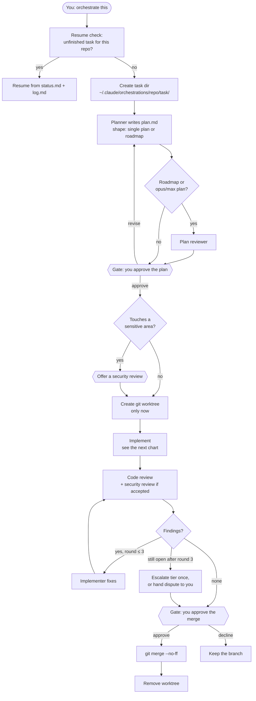
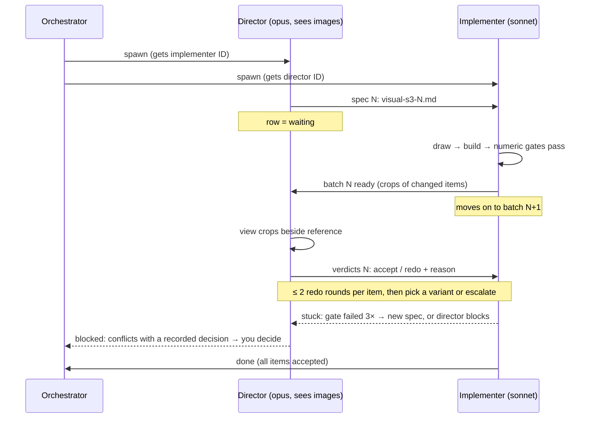
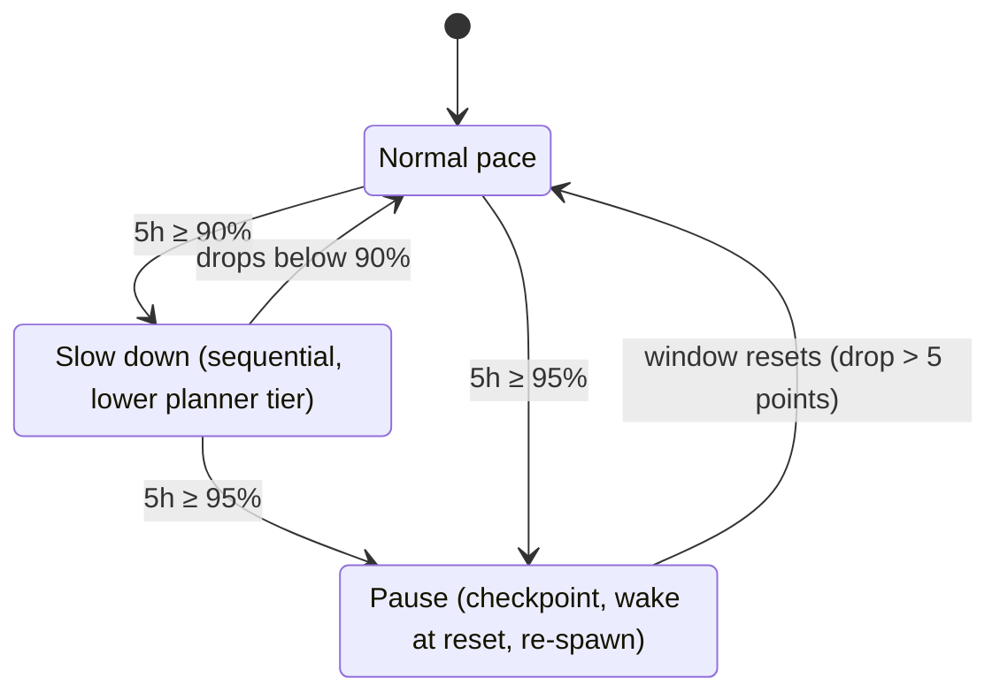
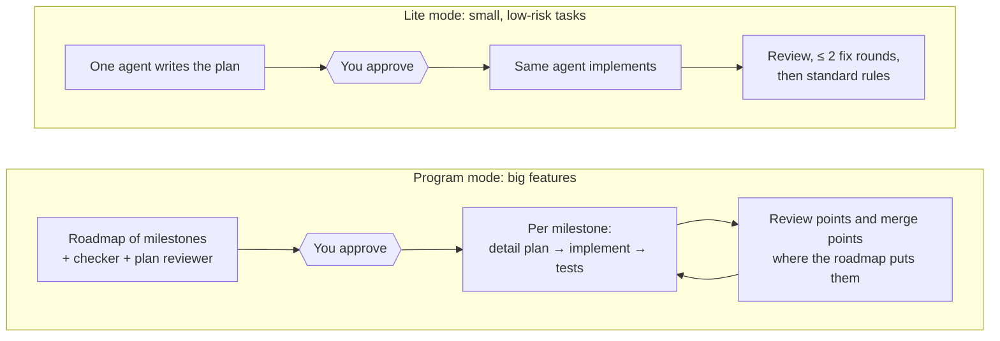

# orch

orch is a multi-agent orchestration skill for [Claude Code](https://code.claude.com). The work
moves through these steps:

1. A **planner** writes a plan, and you approve it.
2. An **implementer** carries out the plan in its own git worktree.
3. A **code reviewer** (and a **security reviewer**, if you accept one) checks the diff, for up to
   3 fix rounds.
4. You approve the merge.

All state lives in Markdown files on disk, so a task survives a crashed session. The orchestrator
picks each role's model and effort level per spawn, records every choice in a journal, and paces
itself against your 5h/7d usage limits. It slows down at 90%, pauses at 95%, and resumes on its own
when the window resets.

Status: in active use, still changing.

## How it works

### The main flow

You approve at two gates, the plan and the merge. Everything between them runs on its own.



### Inside "Implement": the loops that keep a step bounded


### Visual steps: a director judges, a cheaper implementer draws

For steps whose acceptance needs eyes (glyphs, UI, images). The two agents talk directly through
one-line messages that point at a file. The file, `visual-s<step>-<N>.md`, is the record.



### Usage pacing

It reads your 5h usage window from a local cache. No network calls.



### Other modes



Every decision (tier choice, escalation, gate, pilot, check-in) is appended to `journal.jsonl`,
and `bin/orch-stats.sh` aggregates the journals across tasks.

## What's in it

| Path | What |
|---|---|
| `skills/orchestrate/SKILL.md` | The procedure the orchestrator follows |
| `skills/orchestrate/PROGRAM.md` | Program mode: a roadmap of milestones for big features |
| `skills/orchestrate/TIERS.md` | Guide for choosing each role's model and effort |
| `skills/orchestrate/templates/` | One template per task file: plan, status, log, review, journal, … |
| `agents/orch-*.md` | Roles: planner, implementer, code reviewer, security reviewer, plan reviewer, director (visual judgement). **Generated**, do not edit |
| `skills/orchestrate/roles/` | Role sources; `_shared/` holds blocks every role includes |
| `bin/orch-build-agents.py` | Renders `roles/` into `~/.claude/agents/orch-*.md`. Agent files can't import other files at runtime, so shared rules are inlined at build time |
| `agents/explorer.md`, `agents/executor.md` | Cheap helpers that any role can call: read-only lookups, and builds/tests that report a digest |
| `bin/usage-check.sh`, `bin/usage-watch.sh` | Read your usage-limit state from a local cache. No network |
| `bin/orch-ratelimit-cache.sh` | Writes that cache from the statusline input |
| `bin/orch-index.sh`, `bin/orch-index-hook.sh` | Keep `~/.claude/orchestrations/ACTIVE.md`, the list of unfinished tasks |
| `bin/orch-stats.sh`, `bin/role-cost.py` | Analytics over the journals and transcripts |
| `bin/orch-program-check.py` | Checks a program roadmap against its rules |

## Install

Requires Claude Code, `git`, `jq` and `python3`.

```bash
git clone <this repo> orch && cd orch
./install.sh --dry-run   # list what would change
./install.sh             # copy into ~/.claude; any replaced file is backed up first
```

Then add the following to `~/.claude/settings.json`:

```jsonc
{
  "hooks": {
    "PostToolUse": [{ "matcher": "Write|Edit|Bash",
      "hooks": [{ "type": "command", "command": "$HOME/.claude/bin/orch-index-hook.sh" }] }],
    "SessionStart": [{ "hooks": [{ "type": "command",
      "command": "$HOME/.claude/bin/orch-index.sh >/dev/null 2>&1 || true" }] }]
  },
  // Usage pacing needs the rate-limit cache. Use this as your statusline...
  "statusLine": { "type": "command", "command": "$HOME/.claude/bin/orch-ratelimit-cache.sh --print" }
  // ...or, if you already have a statusline script, pipe its stdin through:
  //   input=$(cat); printf '%s' "$input" | ~/.claude/bin/orch-ratelimit-cache.sh
}
```

Without the cache, `usage-check.sh` reports `UNKNOWN`. The skill treats `UNKNOWN` as a warning, so
it runs slowed down the whole time and can't auto-pause or resume. Rate limits appear in the
statusline input only on Pro/Max plans.

To have Claude offer the mode on its own, add a line like this to `~/.claude/CLAUDE.md`:

> Before a new feature, or a bugfix or refactor that spans several files, offer the orchestration
> mode (standard, or lite for small low-risk tasks) alongside normal single-session mode.

## Use

Say "orchestrate this" (or "lite mode" for a small task) and describe the work. Task files go to
`~/.claude/orchestrations/<repo>/<task>/`.

## Maintaining (for the repo owner)

This repo is a sanitised **export** of a live `~/.claude` install. The live files are the source
of truth.

1. Edit the skill in `~/.claude`. For a role, edit `skills/orchestrate/roles/`, then run
   `~/.claude/bin/orch-build-agents.py`; never edit `agents/orch-*.md` directly.
2. Run `scripts/export.py`. It copies the files here, applies its listed edits, and fails if a
   local denylist (kept outside the repo) matches anything.
3. Commit and push.

Don't run `install.sh` over the live install. It would replace live files with the sanitised copies.

## License

MIT. See [LICENSE](LICENSE).
