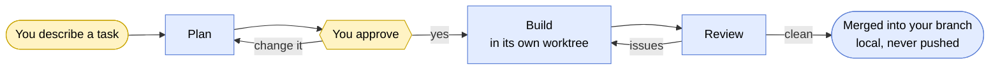
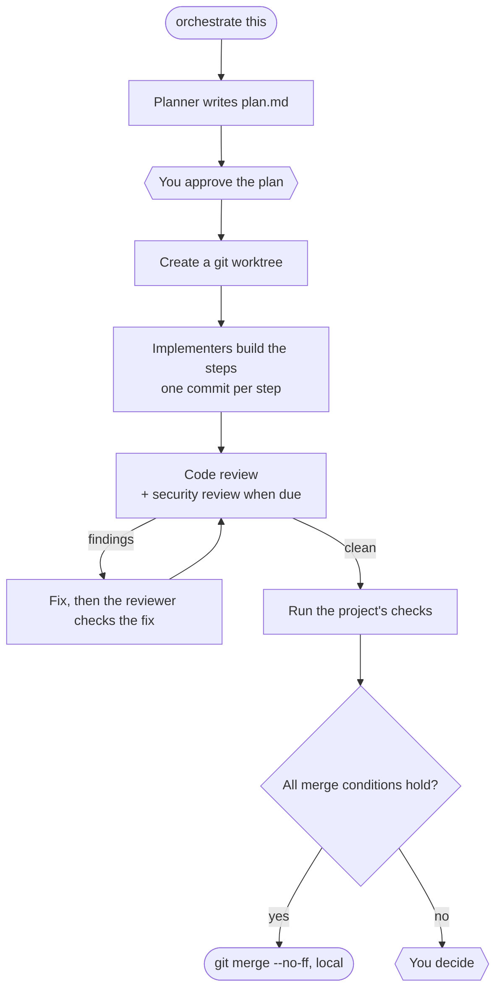
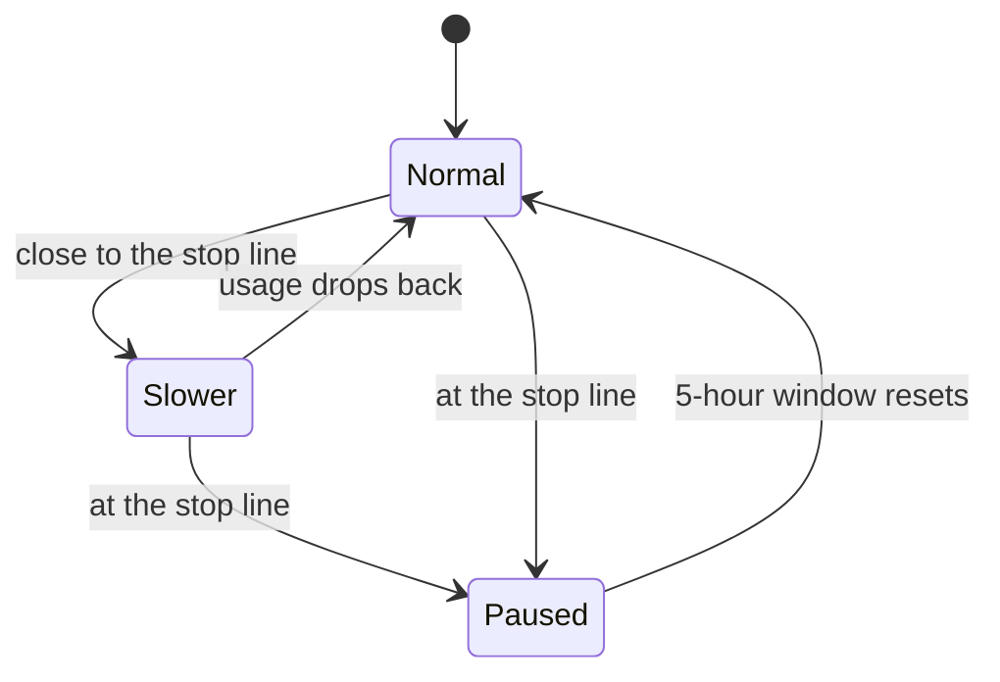

# orch

**Plan it, approve it, and let a small team of agents build, review and merge it.**

orch is a [Claude Code](https://code.claude.com) plugin for multi-step engineering work. You describe a task.
A planner writes a plan. Once you approve it, implementers build it in a separate git worktree, reviewers check
it, and a guarded merge brings it into your branch, locally. orch never pushes.



Yellow is you; blue is the agents. After the plan gate you are only asked what the agents can't decide or undo
themselves.

## Why use it

- **You approve the plan before any code is written.** Everything after that runs on its own.
- **Your branch stays clean.** Work happens in its own worktree and branch, and merges only after review and
  the project's own checks pass. Each merge records the command that reverts it.
- **Independent review.** A code reviewer with a fresh context checks the diff against the plan. A security
  reviewer joins when the change touches security logic or opens something to the network.
- **Nothing is lost when a session dies.** All state is plain Markdown on disk. Say "resume" in the repo and it
  picks up where it stopped.
- **It respects your usage limits.** It watches your 5-hour window, slows down near the limit, pauses before
  it, and resumes by itself after the reset.
- **The right model for each job.** Planning and review run on Opus. Most building runs on Sonnet, and simple
  steps that copy an existing pattern run on Haiku. Every choice is recorded with its reason.
- **Questions don't stop the work.** A question goes to a queue you answer in a side pane. Work it doesn't
  block keeps going.

## Install

Needs Claude Code, `git`, `jq` and Python 3.9 or newer. Works on macOS, Linux and Windows (on Windows,
Claude Code's Bash tool runs in Git Bash, which needs `jq` and Python on its `PATH`).

```
/plugin marketplace add <this repo>
/plugin install orch@orch
```

Two optional steps make it work better:

**1. Let it see your usage.** Pacing reads the rate limits from your statusline input (Pro and Max plans). In
`~/.claude/settings.json`:

```jsonc
{
  "statusLine": { "type": "command", "command": "$HOME/.claude/orch-data/plugin/bin/orch-ratelimit-cache.sh --print" }
  // already have a statusline script? pipe its input through:
  //   input=$(cat); printf '%s' "$input" | ~/.claude/orch-data/plugin/bin/orch-ratelimit-cache.sh
}
```

Without it, orch can't tell how close you are to the limit, so it runs slower the whole time and can't pause
or resume on its own.

**2. Let Claude offer it.** A skill only loads when you ask for it by name. To have Claude offer orch for
bigger tasks, and pick up pending work when you say "resume", add its rules to `~/.claude/CLAUDE.md`:

```bash
~/.claude/orch-data/bin/orch install-instructions --dry-run   # show the change
~/.claude/orch-data/bin/orch install-instructions             # write it (keeps a backup)
```

The rules sit in a marked block: a re-run updates it, and `--uninstall` removes it.

## Use

Say **"orchestrate this"** and describe the work. Claude asks which mode to run:

| Mode | Best for | Who plans | Who builds |
|---|---|---|---|
| **Interactive** (recommended) | most work: you shape the plan together | your session, with you | implementer agents |
| **Standard** | larger or riskier changes | a planner agent | implementer agents |
| **Lite** | small, low-risk tasks | one agent | the same agent |
| **Program** | big features in milestones | a roadmap, then a plan per milestone | implementer agents |

In every mode you approve the plan, and review runs before the merge.

**Pick work back up** by opening a session in the repo (or its worktree) and saying "resume" or "continue".
If one task is clearly yours it resumes; if there are several, Claude asks which.

### Watch and answer in a side pane

```
/orch:pane
```

The pane sits beside the chat and shows each task:
- its goal, state, and progress through its steps;
- the agents running now;
- **Needs you**: the questions agents have parked, each option explained in plain words. Pick one and the
  session carries on.

It opens by itself when you start a session in a repo with an active task. `/orch:ui` opens the settings for
orch-ui, an optional mod that redraws the orchestrator's longer replies in a cleaner layout. It is off by
default, and each redraw costs one model call.

Prefer a browser? `orch dashboard --serve` serves a read-only page on `127.0.0.1:8765`.

## How a task runs



- **Planner.** Reads the code (through a fast lookup helper), writes `plan.md`: summary, decisions, steps with
  their files, risks and how to verify. Large or risky plans get a second look from a plan reviewer before
  they reach you.
- **Implementers.** Each one gets a brief with only what its steps need, works in the worktree, commits each
  step, and stops to ask when the plan turns out to be wrong. It doesn't work around it.
- **Reviewers.** Rate each finding as a blocker, should-fix or nit. Blockers and should-fix go back as one
  batch, and the same reviewer checks the fix. Review rounds are capped. Small nits go to a follow-up list
  instead of holding up the merge.
- **Merge.** `orch merge` checks every condition in code (review passed at this commit, checks passed,
  security rule met, your branch clean) and refuses if one fails. Then it merges with `--no-ff`. It never
  pushes.

### When it asks you

Only these stop the work and come to you straight away: approving the plan, a push, sudo or anything paid, a
destructive action outside the worktree, and a merge the guard refuses. Any other question is queued.

If the choice is reversible and outside security-sensitive code, the agent takes the recommended option and
records it, so you can overrule it later. Everything else waits for your answer in the pane, and only the
steps that depend on it pause.

### Usage pacing



The stop line is around 95–99% of your 5-hour window. It sits lower when stopping later would cost more. When
paused, orch saves its progress and resumes by itself after the reset. All of this is read from local files;
no network calls.

## Where things live

Everything orch keeps is under `~/.claude/orch-data/`. Each task has its own folder:

```
~/.claude/orch-data/tasks/<repo>/<task>/
  plan.md        the approved plan
  status.md      where every role stands
  log.md         one line per event
  review.md      review findings and how each was resolved
  notes.md       working notes, measurements
  questions.md   questions waiting for you, and your answers
  journal.jsonl  every decision with its reason
  retro.md       what went well and what didn't
```

Set `ORCH_DATA` to move everything, or `ORCH_DIR` to move only the tasks.

## The `orch` command

The plugin's own CLI does the bookkeeping, one call per change:
- **State:** `orch status`, `orch show`, `orch current`.
- **Pacing:** `orch usage`.
- **Questions:** `orch ask` and `orch answer`.
- **Merging:** `orch merge`.

Agents use path-free commands that work out which task they are in by themselves: `orch plan --step 3`,
`orch diff`, `orch append notes`, `orch write review`, `orch findings`. `orch --help` lists everything.

## Code index (optional)

On large repositories, orch can use [orch-index](https://github.com/ijat/orch-index), a separate code index for
C/C++, Rust, JS/TS and C#. With it, the lookup helper answers "where is this defined" and "who calls this" in one
query instead of many text searches. It's optional: without it, lookups fall back to `git grep` and `rg`.

orch installs a pinned, checksum-verified release on macOS and Linux the first time it plans in a repo that has
code in one of those languages. Set `ORCH_INDEX_AUTOINSTALL=0` to stop that, or put your own binary on `PATH`.
Windows users download the release zip by hand.

## Contributing

```bash
ORCH_DIR=<scratch dir> claude --plugin-dir <clone>/plugin   # try your copy; /reload-plugins after edits
python3 scripts/check.py                                     # every check, about a minute
```

- Role prompts live in `plugin/skills/orchestrate/roles/`. The files in `plugin/agents/` are generated from
  them:

  ```bash
  python3 scripts/build-agents.py plugin/skills/orchestrate/roles plugin/agents
  ```
- The procedure is `plugin/skills/orchestrate/SKILL.md`. Model choices are in `TIERS.md` beside it, and file
  formats in `templates/`.
- A development copy won't write real task state unless `ORCH_DIR` points at it.

## License

MIT. See [LICENSE](LICENSE).
