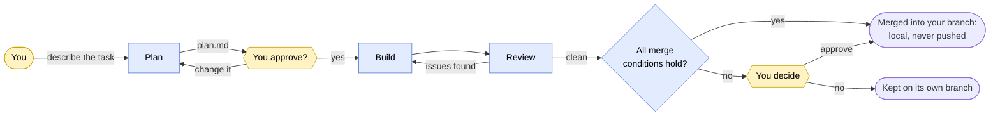
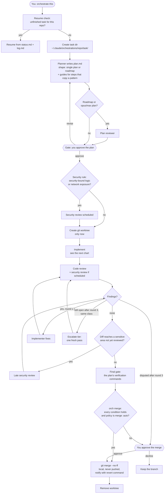
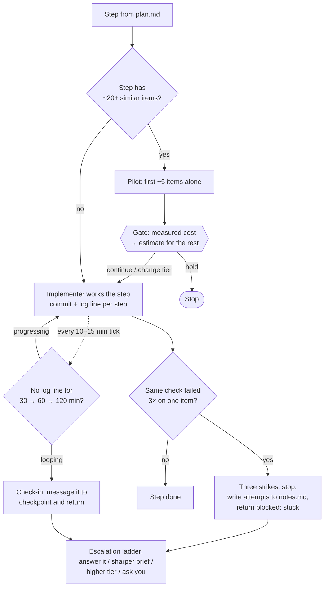
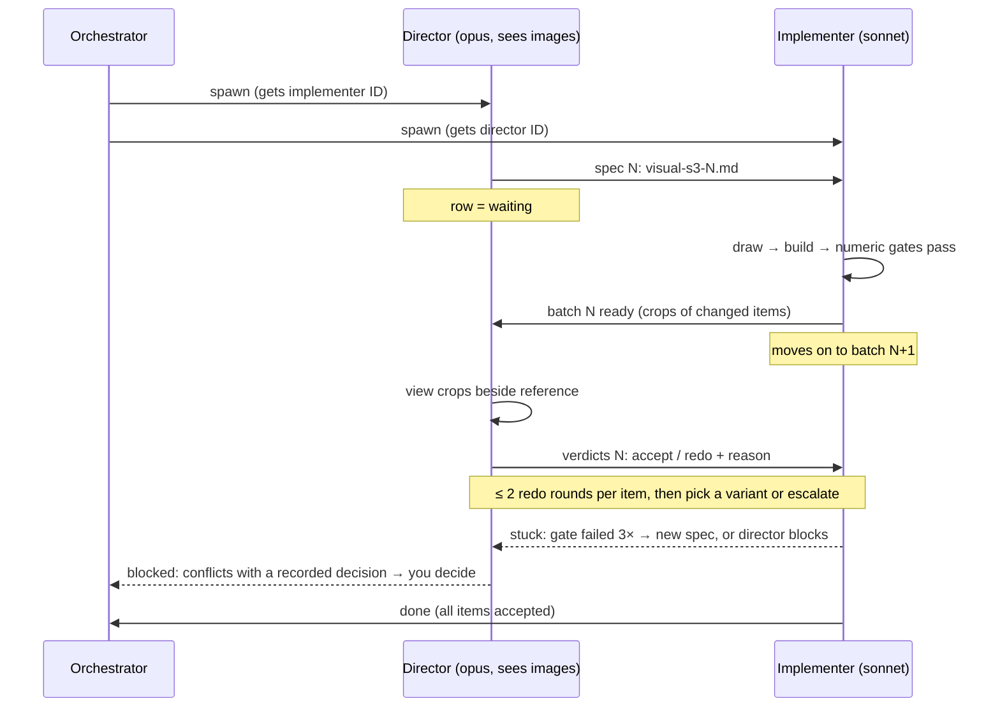
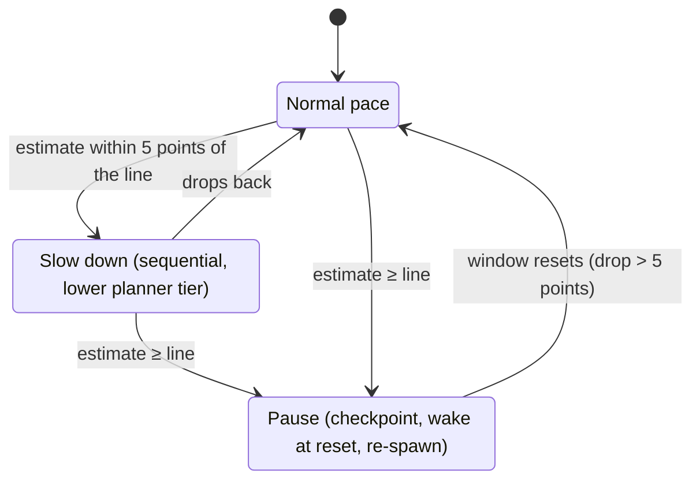
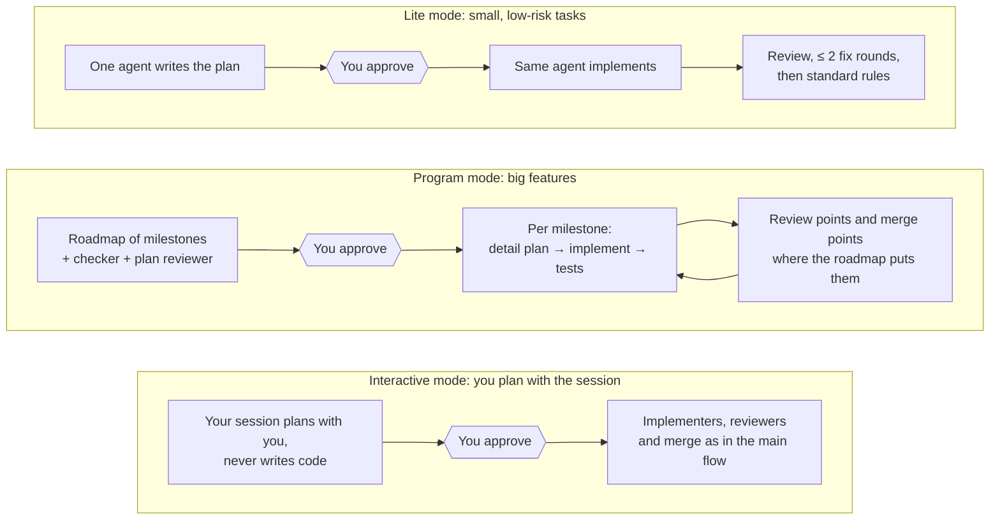

# orch

orch is a multi-agent orchestration skill for [Claude Code](https://code.claude.com). The work
moves through these steps:

1. A **planner** writes a plan, and you approve it. In interactive mode your own session is the planner.
2. An **implementer** carries out the plan in its own git worktree.
3. A **code reviewer** checks the diff, for up to 3 fix rounds. A **security reviewer** also runs
   when a rule says so: a step implements security-bound logic, or the change adds network exposure.
4. When review and the final gate are clean, the orchestrator merges the branch into your base
   branch with a local `git merge --no-ff`. It never pushes. If any merge condition fails, it asks you.

All state lives in Markdown files on disk, so a task survives a crashed session. The orchestrator
picks each role's model and effort level per spawn, records every choice in a journal, and paces
itself against your 5h/7d usage limits. It estimates your live 5h usage, slows down near a dynamic
stop line (about 95-99%), pauses at it, and resumes on its own when the window resets.

Status: in active use, still changing.

## Why use it

You approve the plan. The agents (blue) do the rest, including the build-and-review loop and a
clean merge. They come back to you (yellow) only for what they can't decide or undo themselves.



- **You stay in charge where it matters.** You approve the plan before any code is written. Between
  that gate and the merge it runs on its own. A clean merge is a local `--no-ff` that is journaled with
  a revert command and never pushed. A failed merge condition, a repo whose `policy.md` says
  `merge: ask`, a push, a usage stop, sudo or a paid action all come to you.
- **Questions queue.** When a role needs a decision, a reversible one outside the sensitive areas is
  taken (the recommended option, recorded and listed in the digest). Anything else is parked in the task's `questions.md` and
  everything it doesn't block keeps going. You get one batched question when nothing independent is left.
  A notification goes out only for a parked question, an automatic merge, a hard stop or the end of a task.
- **Work survives crashes and usage limits.** All state lives in Markdown files: plan, status, log,
  review and journal. A dead session, a closed terminal or a usage pause resumes from the files, not
  from scratch.
- **Separate reviewers check the work.** A code reviewer with a fresh context, plus a security reviewer
  when the rule fires (security-bound logic or network exposure; `policy.md` can force it or ask first).
  Every run or skip is journaled. They review against the approved plan, for up to 3 fix rounds.
- **Bookkeeping is one command.** `orch` does each state change in a single call, writes each role's
  brief (just its context), checks the plan, and runs the merge guard. `orch dashboard --serve` shows
  your tasks on a local page.
- **It spends usage deliberately.** Opus plans and reviews. Implementers start cheap: when the repo
  already has a pattern a step can copy, the planner writes a short guide and Haiku does the step;
  otherwise Sonnet does it. Opus implements only steps the planner flags as hard (complex logic, an
  unclear cause, a refusal) or after a cheaper tier fails. Security-bound code stays on Sonnet, because
  the security reviewer is the check there. Every tier choice and escalation goes in the journal with
  its reason. It paces itself against your 5h/7d limits, so a long task pauses instead of hitting the wall.
- **Runs are bounded.** Pilot batches measure cost before a big step. Check-ins catch a silent agent
  that's looping, and three strikes stop retry spirals.
- **It learns.** Mistakes go into a `LESSONS.md`. Lessons that change behaviour get promoted into the
  skill itself, and every decision is journaled for later analysis.

## How it differs from other ways to run agents

| | Plain subagents / one long session | `/goal` (Claude Code) | Dynamic workflows (Claude Code) | **orch** |
|---|---|---|---|---|
| Who decides "done" | the agent itself | a small model reads the conversation after each turn | the script | reviewers against the approved plan, then a merge guard in code (or you, when it fails) |
| Human gates | ad hoc | none until the condition is met | none mid-run | plan approval, then only hard stops, parked questions and a merge the guard refuses |
| Survives a crash | no | goal restored on resume; counters reset | no | yes: every role checkpoints to files |
| Isolation | your branch | your branch | your branch | its own git worktree until the merge |
| Model per role | one | one, plus an evaluator | per agent | per role and per spawn, with a written tradeoff |
| Loop limits | none | a turn cap you write yourself | per script | 3 review rounds, 2 visual redo rounds, three strikes, check-ins |
| Usage pacing | none | pauses on limits | none | estimates live usage, slows near a dynamic stop line (about 95-99%), pauses at it, resumes on its own |

Use `/goal` when one agent can reach a checkable end state, like "tests pass". Use dynamic workflows
for wide fan-out with no human in the loop. Use orch for multi-step engineering work where you want
a plan you approve, independent review and a merge that is local, journaled and revertible.

## Track record (the old skill, before 2026-10-22)

These numbers describe the skill as it was before 2026-10-22: security reviewer by offer, you
approving every merge, bookkeeping by hand. Nothing here measures the current version.

The workflow goes back to late December 2025. It began as a project-specific orchestration skill
inside one repository and evolved into this standalone skill. Records were only kept from
2026-08-27, so the numbers below cover about the last seven weeks, not the whole history. They come
from the skill's own records. Journaled outcomes start on 2026-09-26, when the journal was added. Review findings
are counted from the review files themselves.

| | |
|---|---|
| Tasks run | 84 across 13 repositories |
| Journaled task ends since 2026-09-26 | 41: 36 merged, 1 abandoned, 4 with no outcome recorded |
| Plans | 46 approvals at the gate, 5 sent back for revision there; 13 mid-task revisions (5 after a blocker, 8 asked for by the user) |
| Caught by code review before merge | 18 blockers, 205 should-fix and 287 nits, over 66 reviews |
| Caught by security review | 3 high, 15 medium and 36 low, over 23 reviews |
| Blockers raised by roles | 31; 13 resolved by the orchestrator itself, 4 by a side investigation, 14 by asking the user |
| Usage-limit pauses | 5 pauses, 7 automatic resumes |
| Lessons | 15 promoted from `LESSONS.md` into standing rules |

### What changed because of the data (before 2026-10-22)

- **Tiers chosen per spawn** (2026-10-08). Mean review rounds on merged standard tasks fell from 2.7
  (n=11) to 2.1 (n=9).
  Escalations went from barely logged to logged every time.
- **Batching implementers into ≤ 2 steps** was tried and reverted (2026-10-03). Measured volume went
  up, not down.
- **Planner sketches** were watched as an experiment and kept on 2026-10-28: 19% judged wrong
  over 27 tasks, under the 25% bar for removing them.
- **A full audit on 2026-10-15** found duplicated and drifted role rules and fixed them. The same
  scenarios were run against the old and new role files: existing behaviour scored the same (20/21
  each), and the fixes passed 42/42.

### Since then (2026-10-28 and 2026-10-29)

- **Implementer routing moved down a tier.** Before, about 70% of implementer runs were Opus, and
  Opus was most of the implementer spend. Now Sonnet is the default, security-bound steps included,
  and Opus is kept for flagged hard steps and failures.
- **Guided Haiku.** In a 12-task benchmark with hidden tests and blinded review, Haiku at high effort
  following a planner-written guide scored 9.46/10 (all hidden tests passed) against Sonnet's 9.29, at
  about a fifth of the cost. It trailed only on refactors. A guide is written only when the repo has a
  pattern to copy, and `orch plan-check` rejects a guide that cites no existing file.
- Both routing changes passed a routing benchmark (47 scenarios, the old and new rules side by side)
  before going live.

### Not proven yet

- The `orch` command, the stop policy, the automatic merge and the security rule (2026-10-22) have
  unit tests but no old-versus-new measurement of cost or behaviour yet.
- Sonnet-first routing and guided Haiku have no real-task results yet. They are judged on review
  rounds and findings against the old routing.
- The visual director loop, pilot batches and check-ins (2026-10-15) have run in real tasks, but
  too few to measure.
- Program mode (roadmaps of milestones) has run twice.
- Planner continuation, where the planner implements the first steps itself, has been checked 4
  times and hasn't fired yet (the planner's context was always too full).
- The numbers above come from one person's projects. Your mileage will vary with codebase and model
  versions.

## How it works

### The main flow

You approve the plan. Between that and the merge it runs on its own; you see the merge only if
`orch merge` refuses it.



### Inside "Implement": the loops that keep a step bounded



### Visual steps: a director judges, a cheaper implementer draws

For steps whose acceptance needs eyes (glyphs, UI, images). The two agents talk directly through
one-line messages that point at a file. The file, `visual-s<step>-<N>.md`, is the record.



### Usage pacing

It reads your 5h usage window from a local cache and the session transcripts, and estimates the
current figure between cache updates (`orch usage`). The stop line is dynamic, usually 95-99%: lower when
stopping would cost more (a prompt-cache re-write, live subagents) or the estimate is less certain. A silent
background command (`orch usage wait`) wakes the orchestrator only on an event: stop, reset, check-in. No
network calls.



### Other modes



In **interactive mode** the session you started is the planner: you talk the design through with it
directly instead of through a spawned planner, and it then hands the work to implementers and reviewers
on cheaper models. It never writes product code itself. It plans at your session's model, so start the
session on the model you want planning (say Opus). At the plan gate it offers a fresh session for the
implement/review loop, since the planning conversation makes every later turn more expensive.

Every decision (tier choice, escalation, gate, pilot, check-in) is appended to `journal.jsonl`,
and `bin/orch-stats.sh` aggregates the journals across tasks.

## What's in it

| Path | What |
|---|---|
| `skills/orchestrate/SKILL.md` | The procedure the orchestrator follows |
| `skills/orchestrate/PROGRAM.md` | Program mode: a roadmap of milestones for big features |
| `skills/orchestrate/TIERS.md` | Guide for choosing each role's model and effort, including the implementer routing procedure (guided Haiku, Sonnet default, when Opus) |
| `skills/orchestrate/templates/` | One template per task file: plan, status, log, review, journal, sketch, guide, … |
| `agents/orch-*.md` | Roles: planner, implementer, code reviewer, security reviewer, plan reviewer, director (visual judgement), explorer, graph, executor. **Generated**, do not edit |
| `skills/orchestrate/roles/` | Role sources; `_shared/` holds blocks every role includes |
| `bin/orch-build-agents.py` | Renders `roles/` into `~/.claude/agents/orch-*.md`. Agent files can't import other files at runtime, so shared rules are inlined at build time |
| `bin/orch-build-hook.sh` | PostToolUse hook: re-runs the build whenever a Write, Edit or Bash call touches `roles/`, and reports a failed build back to Claude |
| `agents/orch-explorer.md`, `agents/orch-graph.md`, `agents/orch-executor.md` | Cheap helpers that any role (or any session) can call: read-only lookups, structural code queries answered from an optional code index (see Code index below), and builds/tests that report a digest. Named `explorer`/`executor` before 2026-10-22 |
| `bin/usage-check.sh`, `bin/usage-watch.sh` | One-shot wrapper around `orch usage` (the live estimate and dynamic stop line), and a legacy fixed-threshold watchdog. Local files only, no network |
| `bin/orch-ratelimit-cache.sh` | Writes that cache, and the shared sample log, from the statusline input |
| `bin/orch-index.sh`, `bin/orch-index-hook.sh` | Keep `~/.claude/orchestrations/ACTIVE.md`, the list of unfinished tasks |
| `bin/orch-stats.sh`, `bin/role-cost.py` | Analytics over the journals and transcripts |
| `bin/orch-program-check.py` | Checks a program roadmap against its rules |
| `bin/orch`, `bin/orchlib/` | The `orch` command: one call per state change (`spawn`, `return`, `role`, `journal`, `ask`), role briefs, plan checks (including guides), the guarded `merge`, and `migrate` for old task directories. Python 3.9+ standard library only; `orchlib/tests/` holds its tests |
| `bin/orchlib/dashboard.py`, `bin/orchlib/dashboard.html` | `orch dashboard`: a read-only page of active tasks, questions waiting for you and recent events, served on 127.0.0.1 only |
| `skills/orchestrate/templates/policy.md`, `…/questions.md` | Per-repo stop policy (`~/.claude/orchestrations/<repo>/policy.md`) and the queue of parked questions in a task |

## Code index (optional)

`orch-graph` is a Haiku helper for structural questions about code: where a symbol is defined, who
calls it, every reference to it, which files include or import a file, which classes override a
method. It answers them from `orch-index`, a separate command-line code index that reads a
repository's committed tree (C/C++, Rust, JS/TS, C#) and returns compact `path:line [label]` rows,
each with a trust label (`resolved`, `syntactic`, or an `ambiguous`/`basename`/`parse-errors` mark
that says to check the row). On a large repository one query replaces many text searches.
`orch-explorer` uses the same index first for the same kind of question and keeps its general
search for everything else.

You do not need the index. Nothing in orch builds or installs it, and without it both helpers work
as before: each starts by running `orch-index stats`, and when the binary is missing, the repository
has no index, or the index is behind `HEAD`, the reply opens with `index unavailable: <reason>` and
the answer comes from scoped `git grep`. The helpers never run `orch-index index`; building or
refreshing an index is your job.

To use it:

1. Build `orch-index` from its source with `cargo build --release`.
2. Put the binary on `PATH`, or set `ORCH_INDEX_BIN` to its full path.
3. Run `orch-index index` once inside each repository you want covered (re-run it after commits you
   want to see; it only re-reads changed files).

Callers send structural questions to `orch-graph` (all of a step's questions in one spawn, with the
answer you rely on recorded in `notes.md` for later roles) and everything else to `orch-explorer`.

## Install

Requires Claude Code, `git`, `jq` and Python 3.9 or newer.

Runs on macOS, Linux and Windows. On Windows, Claude Code runs its Bash tool through Git Bash, so run
`install.sh` from Git Bash too, with `jq` and Python on its `PATH`. The scripts look for `python3`, then
`python`; `orch` itself starts from a `#!/usr/bin/env python3` line, so if Git Bash has only `python`,
add a `python3` shim to your `PATH` (e.g. `printf '#!/bin/sh\nexec python "$@"\n' > ~/bin/python3`).
On Windows, task locks use `msvcrt` instead of `fcntl`, and process checks skip `ps`.

```bash
git clone <this repo> orch && cd orch
./install.sh --dry-run   # list what would change
./install.sh             # copy into ~/.claude; any replaced file is backed up first
```

Then add the following to `~/.claude/settings.json`:

```jsonc
{
  "hooks": {
    "PostToolUse": [{ "matcher": "Write|Edit|Bash",
      "hooks": [{ "type": "command", "command": "$HOME/.claude/bin/orch-index-hook.sh" },
                { "type": "command", "command": "$HOME/.claude/bin/orch-build-hook.sh" }] }],
    "SessionStart": [{ "hooks": [{ "type": "command",
      "command": "$HOME/.claude/bin/orch-index.sh >/dev/null 2>&1 || true" }] }]
  },
  // Usage pacing needs the rate-limit cache. Use this as your statusline...
  "statusLine": { "type": "command", "command": "$HOME/.claude/bin/orch-ratelimit-cache.sh --print" }
  // ...or, if you already have a statusline script, pipe its stdin through:
  //   input=$(cat); printf '%s' "$input" | ~/.claude/bin/orch-ratelimit-cache.sh
}
```

To run `orch` as a bare command, link it onto your `PATH` (optional):

```bash
ln -s ~/.claude/bin/orch ~/.local/bin/orch
```

### Upgrading an existing install

```bash
cd orch && git pull
./install.sh --dry-run   # lists new and changed files; new: bin/orch, bin/orchlib/…
./install.sh             # replaced files are backed up first
~/.claude/bin/orch migrate --dry-run   # report what would change in your task directories
~/.claude/bin/orch migrate             # add the new status.md fields to active tasks
~/.claude/bin/orch migrate --all       # optional: finished tasks too
```

`orch migrate` only touches `status.md`. It backs up every file it changes under
`~/.claude/orchestrations/.migrate-backup-<time>/` and never rewrites a plan. Run it when no
session is working on those tasks. Task directories made before the upgrade stay readable; migrating
fills in the new fields, and writes `unknown` where it can't tell. `orch` needs Python 3.9+ and `git`
on the `PATH`.

Without the cache, `usage-check.sh` reports `UNKNOWN`. The skill treats `UNKNOWN` as a warning, so
it runs slowed down the whole time and can't auto-pause or resume. Rate limits appear in the
statusline input only on Pro/Max plans.

### Make Claude use it without being asked

Installing the skill isn't enough on its own: Claude loads a skill only when your request matches its
description, so in practice it runs when you say "orchestrate". To have Claude raise it itself, add this
to `~/.claude/CLAUDE.md` (loaded in every session):

```markdown
## Orchestration mode — offer it before non-trivial work

- Before a new feature, a bugfix or refactor spanning several files, or anything that would warrant a
  written plan: offer me orchestration mode (standard; lite for small, low-risk tasks; interactive to
  plan it with me in this session) or normal single-session mode. Recommend one, let me pick, ask
  once, then get on with it.
- Don't offer it for questions, read-only research, trivial edits, or when I already chose the approach.
- If I pick it, load the `orchestrate` skill and follow it. Orchestration tasks run in a git worktree
  by default: choosing the mode is the request.
```

To skip the question, replace the first bullet with "When a task would warrant orchestration mode, use
it without asking first." To make planning together the default, end it with "Recommend interactive
mode when the task needs a real plan."

## Use

Say "orchestrate this" (or "lite mode" for a small task, or "orchestrate interactive" to plan it with
the session) and describe the work. Task files go to
`~/.claude/orchestrations/<repo>/<task>/`.

To watch your tasks, run `orch dashboard --serve` (add `--port N` to change the port, `--open` to open
a browser). It serves a read-only page on `127.0.0.1:8765` and writes nothing. `orch dashboard --json`
prints the same data once.

## Maintaining (for the repo owner)

This repo is the **source of truth** for the owner's live `~/.claude` orch files. Edit here, never
in `~/.claude`.

`scripts/sync-live.py` (POSIX only) writes the live install from a commit of this repo plus a private
overlay kept outside the repo. The overlay holds the few live-only differences (pointers to files that
exist only on the owner's machine). Before it touches anything it builds the new live image in a temp
stage and checks it:

- script syntax;
- the rendered agents (`orch-build-agents.py --check`);
- the owner's audit checks, which must print no new warnings;
- a **round trip**: `scripts/export.py`, run against the stage, must reproduce the commit byte for byte
  and pass the denylist scan.

Only then does it write, all-or-nothing: record, back up every file it will replace, atomic replace,
the same checks on live, and a manifest of file hashes. Any failure restores from the backups. A drift
guard compares live with the manifest and refuses to overwrite files edited by hand (there is no
`--force`). `scripts/sync-live.py --rollback` undoes the newest sync. `--dry-run` shows everything and
writes nothing.

A sync replaces files one at a time, so don't start `orch` commands or orchestrations in other sessions
while it runs.

sync-live refuses a commit that does not descend from the last synced one unless
`--allow-non-descendant` is given, and it lists the managed files that would revert.

`install.sh` refuses (exit 2) when `~/.claude/.orch-sync` exists, so it can never overwrite a
sync-managed install.

Workflow:

1. Branch, then edit. For a role, edit `skills/orchestrate/roles/`; never edit `agents/orch-*.md`
   directly. Render them with `python3 bin/orch-build-agents.py skills/orchestrate/roles agents`.
2. Test: `python3 scripts/test_export.py`, `python3 -m unittest discover -s bin/orchlib/tests`,
   `node --test bin/orchlib/tests/test_dashboard_page.mjs`.
3. Commit, then `scripts/sync-live.py --dry-run` and `scripts/sync-live.py`.
4. Merge with `git merge --no-ff`, then push.

`scripts/export.py` is the inverse of the sync: it maps a live install back to this repo's form
(dropping owner-only pointers, making examples generic) and checks the result against a local denylist
kept outside the repo. sync-live runs it as its round-trip proof.

## License

MIT. See [LICENSE](LICENSE).
