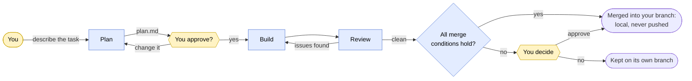
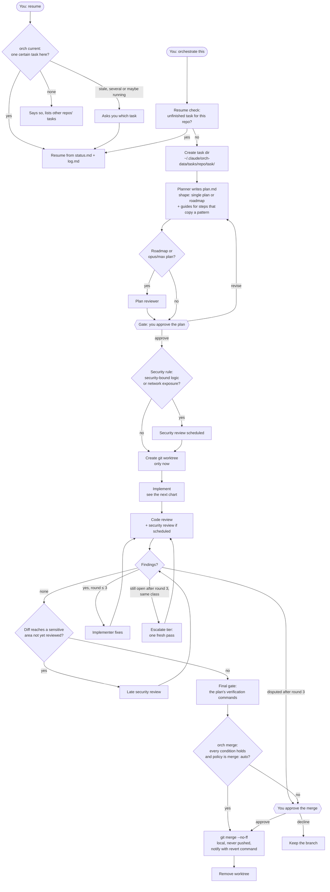
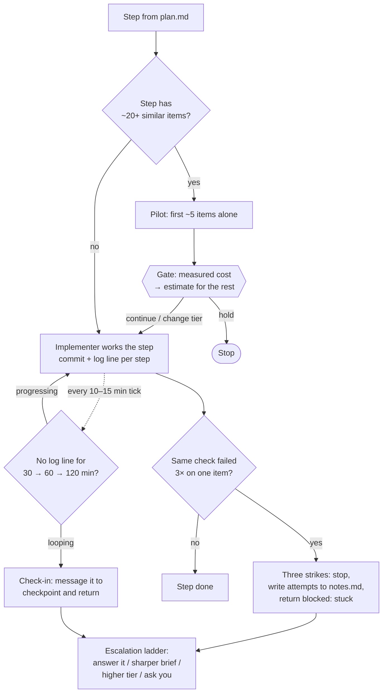
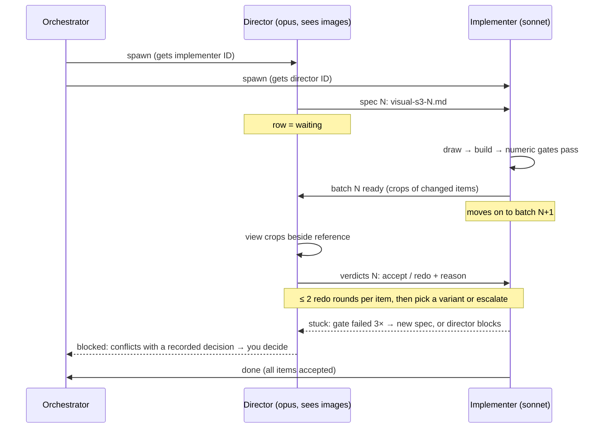
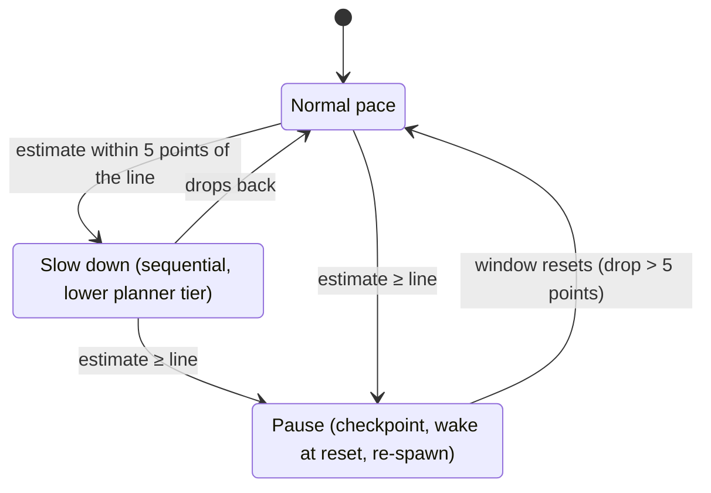
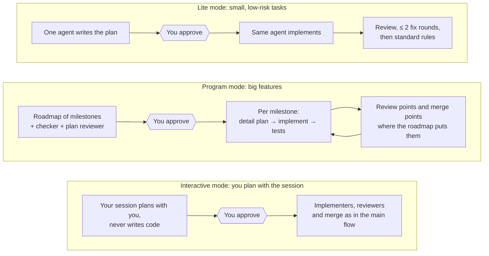

# orch

orch is a multi-agent orchestration skill for [Claude Code](https://code.claude.com). The work
moves through these steps:

1. A **planner** writes a plan, and you approve it. In interactive mode your own session is the planner.
2. An **implementer** carries out the plan in its own git worktree.
3. A **code reviewer** checks the diff, for up to 3 fix rounds. A **security reviewer** also runs
   when a rule says so: a step implements security-bound logic, or the change adds network exposure.
4. When review and the final gate are clean, the orchestrator merges the branch into your base
   branch with a local `git merge --no-ff`. It never pushes. If any merge condition fails, it asks you.

All state lives in Markdown files on disk, so a task survives a crashed session. The orchestrator
picks each role's model and effort level per spawn, records every choice in a journal, and paces
itself against your 5h/7d usage limits. It estimates your live 5h usage, slows down near a dynamic
stop line (about 95-99%), pauses at it, and resumes on its own when the window resets.

Status: in active use, still changing.

## Why use it

You approve the plan. The agents (blue) do the rest, including the build-and-review loop and a
clean merge. They come back to you (yellow) only for what they can't decide or undo themselves.



- **You stay in charge where it matters.** You approve the plan before any code is written. Between
  that gate and the merge it runs on its own. A clean merge is a local `--no-ff` that is journaled with
  a revert command and never pushed. A failed merge condition, a repo whose `policy.md` says
  `merge: ask`, a push, a usage stop, sudo or a paid action all come to you.
- **Questions queue.** When a role needs a decision, a reversible one outside the sensitive areas is
  taken (the recommended option, recorded and listed in the digest). Anything else is parked in the task's `questions.md` and
  everything it doesn't block keeps going. Agents park every question for orch-pane (`orch ask`, `--multi` when several options may be picked), never in text or an
  `AskUserQuestion` dialog, each option with a plain explanation; `orch answers` takes your answers and
  `orch status --json` carries a `questions` block. You get one batched question when nothing independent is left.
  A notification goes out only for a parked question, an automatic merge, a hard stop or the end of a task.
- **Work survives crashes and usage limits.** All state lives in Markdown files: plan, status, log,
  review and journal. A dead session, a closed terminal or a usage pause resumes from the files, not
  from scratch. Say "resume" in the repo and it finds the task itself.
- **Separate reviewers check the work.** A code reviewer with a fresh context, plus a security reviewer
  when the rule fires (security-bound logic or network exposure; `policy.md` can force it or ask first).
  Every run or skip is journaled. They review against the approved plan, for up to 3 fix rounds.
- **Bookkeeping is one command.** `orch` does each state change in a single call, writes each role's
  brief (just its context), checks the plan, and runs the merge guard. `orch dashboard --serve` shows
  your tasks on a local page.
- **It spends usage deliberately.** Opus plans and reviews. Implementers start cheap: when the repo
  already has a pattern a step can copy, the planner writes a short guide and Haiku does the step;
  otherwise Sonnet does it. Opus implements only steps the planner flags as hard (complex logic, an
  unclear cause, a refusal) or after a cheaper tier fails. Security-bound code stays on Sonnet, because
  the security reviewer is the check there. Every tier choice and escalation goes in the journal with
  its reason. It paces itself against your 5h/7d limits, so a long task pauses instead of hitting the wall.
- **Runs are bounded.** Pilot batches measure cost before a big step. Check-ins catch a silent agent
  that's looping, and three strikes stop retry spirals.
- **It learns.** Mistakes go into a `LESSONS.md`. Lessons that change behaviour get promoted into the
  skill itself, and every decision is journaled for later analysis.

## How it differs from other ways to run agents

| | Plain subagents / one long session | `/goal` (Claude Code) | Dynamic workflows (Claude Code) | **orch** |
|---|---|---|---|---|
| Who decides "done" | the agent itself | a small model reads the conversation after each turn | the script | reviewers against the approved plan, then a merge guard in code (or you, when it fails) |
| Human gates | ad hoc | none until the condition is met | none mid-run | plan approval, then only hard stops, parked questions and a merge the guard refuses |
| Survives a crash | no | goal restored on resume; counters reset | no | yes: every role checkpoints to files |
| Isolation | your branch | your branch | your branch | its own git worktree until the merge |
| Model per role | one | one, plus an evaluator | per agent | per role and per spawn, with a written tradeoff |
| Loop limits | none | a turn cap you write yourself | per script | 3 review rounds, 2 visual redo rounds, three strikes, check-ins |
| Usage pacing | none | pauses on limits | none | estimates live usage, slows near a dynamic stop line (about 95-99%), pauses at it, resumes on its own |

Use `/goal` when one agent can reach a checkable end state, like "tests pass". Use dynamic workflows
for wide fan-out with no human in the loop. Use orch for multi-step engineering work where you want
a plan you approve, independent review and a merge that is local, journaled and revertible.

## Track record (the old skill, before 2026-10-22)

These numbers describe the skill as it was before 2026-10-22: security reviewer by offer, you
approving every merge, bookkeeping by hand. Nothing here measures the current version.

The workflow goes back to late December 2025. It began as a project-specific orchestration skill
inside one repository and evolved into this standalone skill. Records were only kept from
2026-08-27, so the numbers below cover about the last seven weeks, not the whole history. They come
from the skill's own records. Journaled outcomes start on 2026-09-26, when the journal was added. Review findings
are counted from the review files themselves.

| | |
|---|---|
| Tasks run | 84 across 13 repositories |
| Journaled task ends since 2026-09-26 | 41: 36 merged, 1 abandoned, 4 with no outcome recorded |
| Plans | 46 approvals at the gate, 5 sent back for revision there; 13 mid-task revisions (5 after a blocker, 8 asked for by the user) |
| Caught by code review before merge | 18 blockers, 205 should-fix and 287 nits, over 66 reviews |
| Caught by security review | 3 high, 15 medium and 36 low, over 23 reviews |
| Blockers raised by roles | 31; 13 resolved by the orchestrator itself, 4 by a side investigation, 14 by asking the user |
| Usage-limit pauses | 5 pauses, 7 automatic resumes |
| Lessons | 15 promoted from `LESSONS.md` into standing rules |

### What changed because of the data (before 2026-10-22)

- **Tiers chosen per spawn** (2026-10-08). Mean review rounds on merged standard tasks fell from 2.7
  (n=11) to 2.1 (n=9).
  Escalations went from barely logged to logged every time.
- **Batching implementers into ≤ 2 steps** was tried and reverted (2026-10-03). Measured volume went
  up, not down.
- **Planner sketches** were watched as an experiment and kept on 2026-10-28: 19% judged wrong
  over 27 tasks, under the 25% bar for removing them.
- **A full audit on 2026-10-15** found duplicated and drifted role rules and fixed them. The same
  scenarios were run against the old and new role files: existing behaviour scored the same (20/21
  each), and the fixes passed 42/42.

### Since then (2026-10-28 and 2026-10-29)

- **Implementer routing moved down a tier.** Before, about 70% of implementer runs were Opus, and
  Opus was most of the implementer spend. Now Sonnet is the default, security-bound steps included,
  and Opus is kept for flagged hard steps and failures.
- **Guided Haiku.** In a 12-task benchmark with hidden tests and blinded review, Haiku at high effort
  following a planner-written guide scored 9.46/10 (all hidden tests passed) against Sonnet's 9.29, at
  about a fifth of the cost. It trailed only on refactors. A guide is written only when the repo has a
  pattern to copy, and `orch plan-check` rejects a guide that cites no existing file.
- Both routing changes passed a routing benchmark (47 scenarios, the old and new rules side by side)
  before going live.

### Not proven yet

- The `orch` command, the stop policy, the automatic merge and the security rule (2026-10-22) have
  unit tests but no old-versus-new measurement of cost or behaviour yet.
- Sonnet-first routing and guided Haiku have no real-task results yet. They are judged on review
  rounds and findings against the old routing.
- The visual director loop, pilot batches and check-ins (2026-10-15) have run in real tasks, but
  too few to measure.
- Program mode (roadmaps of milestones) has run twice.
- Taking over on a bare "resume" (2026-11-06) passed trigger probes: it fired on 10 of 10 resume prompts
  and 0 of 8 others. A full resume through that path has not been run yet.
- The numbers above come from one person's projects. Your mileage will vary with codebase and model
  versions.

## How it works

### The main flow

You approve the plan. Between that and the merge it runs on its own; you see the merge only if
`orch merge` refuses it.



### Inside "Implement": the loops that keep a step bounded



### Visual steps: a director judges, a cheaper implementer draws

For steps whose acceptance needs eyes (glyphs, UI, images). The two agents talk directly through
one-line messages that point at a file. The file, `visual-s<step>-<N>.md`, is the record.



### Usage pacing

It reads your 5h usage window from a local cache and the session transcripts, and estimates the
current figure between cache updates (`orch usage`). The stop line is dynamic, usually 95-99%: lower when
stopping would cost more (a prompt-cache re-write, live subagents) or the estimate is less certain. A silent
background command (`orch usage wait`) wakes the orchestrator only on an event: stop, reset, check-in. No
network calls.



### Other modes



In **interactive mode** the session you started is the planner: you talk the design through with it
directly instead of through a spawned planner, and it then hands the work to implementers and reviewers
on cheaper models. It never writes product code itself. It plans at your session's model, so start the
session on the model you want planning (say Opus). At the plan gate it offers a fresh session for the
implement/review loop, since the planning conversation makes every later turn more expensive.

Every decision (tier choice, escalation, gate, pilot, check-in) is appended to `journal.jsonl`,
and `bin/orch-stats.sh` aggregates the journals across tasks.

## What's in it

| Path | What |
|---|---|
| `skills/orchestrate/SKILL.md` | The procedure the orchestrator follows |
| `skills/orchestrate/PROGRAM.md` | Program mode: a roadmap of milestones for big features |
| `skills/orchestrate/LITE.md`, `INTERACTIVE.md`, `VISUAL.md` | Loaded only for lite mode, interactive mode, and visual or pilot steps |
| `skills/orchestrate/TIERS.md` | Guide for choosing each role's model and effort, including the implementer routing procedure (guided Haiku, Sonnet default, when Opus) |
| `skills/orch-init/` | Project initialization skill: sets up a new or empty repo (short canonical `CLAUDE.md`, `AGENTS.md` pointer, `docs/STATE.md`, `docs/DECISIONS.md`, offered extras), audits an existing one on request, refreshes once after the first merge. `templates/` and per-ecosystem `references/`, with one architecture guide (swappable interfaces at every boundary) |
| `skills/orchestrate/templates/` | One template per task file: plan, status, log, review, journal, sketch, guide, … |
| `agents/*.md` | Roles: planner, implementer, code reviewer, security reviewer, plan reviewer, director (visual judgement), explorer, graph (code-index maintainer), executor, init (project setup, for the `orch-init` skill). **Generated**, do not edit |
| `skills/orchestrate/roles/` | Role sources; `_shared/` holds blocks every role includes |
| `scripts/build-agents.py` | Renders `roles/` into the agent files. Agent files can't import other files at runtime, so shared rules are inlined at build time; `--check` fails when an agent file differs from its role |
| `bin/orchlib/hook.py` (`orch hook delegate`) | A PreToolUse hook that denies repo-wide searches on an indexed repository. **Not wired into any role** since 2026-11-01 (it blocked Sonnet implementer work); the roles are told to prefer `orch:explorer` instead. Kept as a tool, see Code index below |
| `agents/explorer.md`, `agents/graph.md`, `agents/executor.md` | Cheap helpers that any role (or any session) can call: read-only lookups (using an optional code index when there is one, see Code index below), keeping that index fresh (`orch:graph`: the orchestrator, the planner or you call it, not the other roles), and builds/tests that report a digest. Named `explorer`/`executor` before 2026-10-22 |
| `bin/usage-check.sh`, `bin/usage-watch.sh` | One-shot wrapper around `orch usage` (the live estimate and dynamic stop line), and a legacy fixed-threshold watchdog. Local files only, no network |
| `bin/orch-ratelimit-cache.sh` | Writes that cache, and the shared sample log, from the statusline input |
| `bin/orch-index.sh`, `bin/orch-index-hook.sh` | Keep `~/.claude/orch-data/tasks/ACTIVE.md`, the list of unfinished tasks |
| `bin/orch-stats.sh`, `bin/role-cost.py` | Analytics over the journals and transcripts |
| `bin/orch-program-check.py` | Checks a program roadmap against its rules |
| `bin/orch-install-code-index.sh` | Installs the pinned `orch-index` release binary (macOS and Linux) for `orch:graph`, see Code index below |
| `bin/orch`, `bin/orchlib/` | The `orch` command: one call per state change (`spawn`, `return`, `role`, `journal`, `ask`), role briefs, plan checks (including guides), the guarded `merge`, and `migrate` for old task directories. Python 3.9+ standard library only; `orchlib/tests/` holds its tests |
| `bin/orchlib/dashboard.py`, `bin/orchlib/dashboard.html` | `orch dashboard`: a read-only page of active tasks, questions waiting for you and recent events, served on 127.0.0.1 only |
| `bin/orchlib/current.py` | `orch current`: maps a directory or worktree to its task and prints `resume`, `ask` or `none`. Read-only |
| `bin/orchlib/instructions.py`, `skills/orchestrate/templates/claude-md-block.md` | `orch install-instructions`: writes, updates or removes the rules block in `~/.claude/CLAUDE.md` |
| `skills/orchestrate/templates/policy.md`, `…/questions.md` | Per-repo stop policy (`~/.claude/orch-data/tasks/<repo>/policy.md`) and the queue of parked questions in a task |

## Code index (optional)

`orch-index` is a separate command-line code index. It reads a repository's committed tree (C/C++,
Rust, JS/TS, C#) and answers structural questions (where a symbol is defined, who calls it, every
reference, which files include or import a file, which classes override a method) as compact
`path:line [label]` rows, each with a trust label (`resolved`, `syntactic`, or an
`ambiguous`/`basename`/`parse-errors` mark that says to check the row). On a large repository one
query replaces many text searches (per `orch-index`'s own benchmark).

Two roles use it, and only two:

- **`orch:explorer` queries it.** Its first command is `orch-index stats`; when the index is current it
  answers structural questions from it, and it searches with `git grep` / `rg` for everything else
  (other languages, rows marked as uncertain). When the index commit is `HEAD`'s ancestor (for
  example in a task worktree after its first commit), the index is still used: the explorer also
  searches the files changed since that commit (renames included) and says
  `index at <sha> + delta search`. The `index at …, HEAD is …` note `orch-index` prints on such a
  query is expected there, not a stale signal. When the index is stale (its commit is not an ancestor
  of `HEAD`, or its commit equals `HEAD` and the query note says `index built by an older orch-index`;
  `orch-index` shows that note only when the commit equals `HEAD`), the reply opens with
  `index unavailable: stale (<reason>) (refresh: orch:graph)`, without the refresh hint in a linked
  worktree (the index is shared with the main checkout); when the binary is missing
  or the repository has no index, it opens with a bare `index unavailable: <reason>`. In both cases the
  answer comes from scoped search, so answers are the same without an index; the first command adds about one call per request (in this task's probes on small repositories: +15-30% tokens without an index, and +20-50% with one, where grep alone is cheaper). The explorer never builds or refreshes the index.
- **`orch:graph` keeps it fresh.** It checks the index (`fresh`, `fresh-enough` when the index commit
  is an ancestor of `HEAD`, `stale`, `missing`, or `binary not found`) and, when it is stale or
  missing, rebuilds it (incremental when an index exists), then reports the state before and after.
  When the binary is missing it may install it once (conditions below).
  It leaves a `fresh-enough` index alone unless asked to bring it to `HEAD`, and it rebuilds only in
  the main checkout: from a linked worktree it reports the state and the main checkout's path. It answers no code
  questions. Only you, the orchestrator and the planner call it, the other roles do not:
  - **Before every plan,** the orchestrator asks for a `pre-plan` run in the main checkout, in every
    mode (standard, lite, interactive, each program milestone), on a repository of any size. It stops
    with `no indexable files` when the repository has no tracked file in a supported language; otherwise it
    builds a missing index and rebuilds one that is stale or behind `HEAD`, and leaves a current one alone.
    The orchestrator logs the state (`pre-plan index: <state>`). This is the call that may install a
    missing binary.
  - **On a stale hint,** the orchestrator or planner, when the explorer reports a stale index
    (`… (refresh: orch:graph)`) on a repository that has one.

While `orch:graph` rebuilds, it writes a marker file, `<git-common-dir>/orch-index/indexing`, and
removes it afterwards, only if the file still holds its own line; if a live marker from another run
is already there, it reports `index busy` and stops. During the rebuild the orchestrator and the planner start no other agent and
do no exploring of their own, and the explorer's first command waits (up to five minutes) for a live
marker before it queries. A marker whose process is gone, or that is over 30 minutes old, is ignored.
This is a rule the roles follow, not a lock: another person's session, or a role that never reads the
rule, is not blocked.

**Delegation hook (unwired).** `orch hook delegate` can deny a repo-wide Grep, Glob or Bash search on an indexed
repository and tell the caller to spawn `orch:explorer`. It was declared in the frontmatter of `orch-implementer`
and `orch-code-reviewer` from 2026-11-01 and removed the same day: the deny stopped Sonnet in the middle of
legitimate work. Those roles now carry a strong "prefer the explorer" rule in their prompt and nothing enforces it.
The command and its tests remain; wire it back by adding a PreToolUse `Grep|Glob|Bash` hook to a role's frontmatter.

You do not need the index. The binary is `$ORCH_INDEX_BIN` if set, else `orch-index` on `PATH`, else
`${ORCH_DATA:-$HOME/.claude/orch-data}/bin/orch-index`.

**Automatic install.** `orch:graph` installs a missing binary only when the caller did not ask for check only,
`ORCH_INDEX_AUTOINSTALL` is not `0`, `ORCH_INDEX_BIN` is unset or empty, no `orch-index` is on `PATH`,
and `~/.claude/orch-data/bin/orch-index` does not exist; it then runs `orch-install-code-index.sh`
once (Bash timeout 300 s) and, if `stats` still fails after that, reports the script's last line and
stops. The calls that can install are the orchestrator's pre-plan call (before any plan, on a repository
with at least one tracked file in a supported language) and your own. The script supports macOS and Linux (x86_64 and arm64). It downloads the
pinned release over HTTPS from `github.com/ijat/orch-index`, checks the archive's SHA-256
against hashes committed in this repository (it does not trust the release's own checksum file), accepts
only the one expected binary from the archive, checks that `--version` matches the pin, and writes it to
`~/.claude/orch-data/bin/orch-index` (no `sudo`, an existing binary is never overwritten). If `gh` is present it
also reports whether the archive's build attestation verifies. A repository with no tracked file in a
supported language is not touched, and the explorer never installs anything. To avoid the install: set `ORCH_INDEX_AUTOINSTALL=0` (the script
then exits 3 without network access and `orch:graph` reports `install disabled`), or provide your own
binary (`ORCH_INDEX_BIN` set to a working path, `orch-index` on `PATH`, or a file at
`~/.claude/orch-data/bin/orch-index`, which is never overwritten). `ORCH_INDEX_AUTOINSTALL=0` only stops
installs; an existing binary is still used. Your own check-only calls never install, but the
orchestrator's pre-plan call is not check only. The installer does not handle Windows: each orch-index release carries
a prebuilt Windows zip, which you download and unzip yourself (the orch-index README has a PowerShell
recipe). Other platforms install by hand too.

Manual steps:

1. Download the archive for your platform from the release page at `github.com/ijat/orch-index`
   (Windows: the zip) and unpack it.
2. Put the binary on `PATH`, or set `ORCH_INDEX_BIN` to its full path (or place it at
   `~/.claude/orch-data/bin/orch-index`).
3. Ask for `orch:graph` once per repository (or run `orch-index index` yourself inside it); later
   calls only re-read changed files.

## Install

Requires Claude Code, `git`, `jq` and Python 3.9 or newer. Runs on macOS, Linux and Windows (on Windows,
Claude Code runs its Bash tool through Git Bash, which needs `jq` and Python on its `PATH`; the scripts
look for `python3`, then `python`).

```
/plugin marketplace add <this repo>
/plugin install orch@orch
```

Everything orch stores (tasks, logs, caches, the code-index binary) lives under `~/.claude/orch-data/`.
Move it with `ORCH_DATA`; `ORCH_DIR` moves only the tasks.

Usage pacing needs the rate-limit cache, which comes from your statusline input. Add this to
`~/.claude/settings.json`, or pipe your own statusline script's stdin through the second form:

```jsonc
{
  "statusLine": { "type": "command", "command": "$HOME/.claude/orch-data/plugin/bin/orch-ratelimit-cache.sh --print" }
  // or, with a statusline script of your own:
  //   input=$(cat); printf '%s' "$input" | ~/.claude/orch-data/plugin/bin/orch-ratelimit-cache.sh
}
```

The `plugin` link in the data folder points at the installed copy and is refreshed at every session start.
To run `orch` as a bare command from a terminal, alias it to `~/.claude/orch-data/bin/orch`.

Without the cache, `usage-check.sh` reports `UNKNOWN`. The skill treats `UNKNOWN` as a warning, so
it runs slowed down the whole time and can't auto-pause or resume. Rate limits appear in the
statusline input only on Pro/Max plans.

### Make Claude use it without being asked

Installing the plugin isn't enough on its own: Claude loads a skill only when your request matches its
description, so in practice it runs when you say "orchestrate". To have Claude offer it, and take over
pending work when you say "resume" or "continue", install the rules into `~/.claude/CLAUDE.md`
(loaded in every session):

```bash
~/.claude/orch-data/bin/orch install-instructions --dry-run   # print the diff
~/.claude/orch-data/bin/orch install-instructions             # write it, with a backup beside the file
```

The rules go in a marked block, so a re-run updates them and `--uninstall` removes them; your other text
is left alone. Edits inside the block are lost on a re-run. If the file already has hand-written orch
rules, the command refuses rather than duplicate them: check `--dry-run --replace-existing`, then run with
`--replace-existing` to swap them for the block.

## Use

Say "orchestrate this" (or "lite mode" for a small task, or "orchestrate interactive" to plan it with
the session) and describe the work. Task files go to
`~/.claude/orch-data/tasks/<repo>/<task>/`.

To pick work back up, open a new session in the repo or its worktree and say "resume", "continue", "start"
or the same thing in other words. This needs the rules from `orch install-instructions`. Claude runs
`orch current`, which matches the directory against each task's recorded repo path and worktree:

| `orch current` says | When | What Claude does |
|---|---|---|
| `resume <repo>/<slug>` | One live task here | Resumes it without asking |
| `ask` | Tasks here, but none is certain: stale over 7 days, several live, matched by folder name only, or touched in the last 15 minutes (another session may be running it) | Asks you which one |
| `none` | No active task here | Says so, lists other repos' tasks, and offers the next step from the project's `STATE.md` if it has one |

From inside a task's worktree, that task wins over the repo's others. In a session already working on
something, "continue" just means carry on, and a prompt that names other work is that work.
`orch show` lists every repo's unfinished tasks.

To watch your tasks, run `orch dashboard --serve` (add `--port N` to change the port, `--open` to open
a browser). It serves a read-only page on `127.0.0.1:8765` and writes nothing. `orch dashboard --json`
prints the same data once.

## Developing orch

Work in a clone of this repo and try a change in a session that loads it directly:

```bash
ORCH_DIR=<scratch dir> claude --plugin-dir <clone>/plugin   # then /reload-plugins after an edit
```

A copy that is not the installed one is a development copy: it refuses to write real orch state unless
`ORCH_DIR` says where, and it never moves the `plugin` link.

- Roles: edit `plugin/skills/orchestrate/roles/`, never `plugin/agents/` by hand, then render with
  `python3 scripts/build-agents.py plugin/skills/orchestrate/roles plugin/agents`.
- Check: `python3 scripts/check.py` runs the agent render check, `claude plugin validate`, every Python test
  class (in parallel), the orch-pane and orch-ui suites (`claude plugin test plugin`) and the public-safety scan, one line each. `--only NAME,…` picks some.
- Public safety: `scripts/check-public.py` fails when a published file, path or commit message matches a private
  denylist. Link `githooks/pre-push` as `.git/hooks/pre-push` to run it on exactly the commits being pushed.
- Release: push, then `claude plugin marketplace update orch && claude plugin update orch@orch`.

## License

MIT. See [LICENSE](LICENSE).
